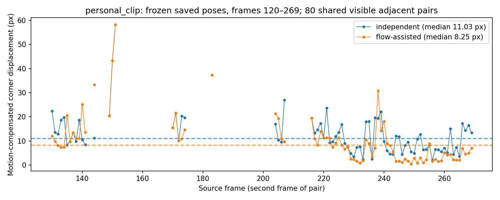

# CS4243 Lab 2 report

**Authors:** Alden (A0273071L), Paul Cheng (A0272538X)

This report evaluates a classical pipeline for board localisation, optical-flow tracking and occlusion-aware advertisement compositing. Settings are frozen on the common clip's validation data and applied to the common test subset, stress clips and personal clip. The generated stress tables summarise Stages 1–3; the personal Overlay Scorecard and same-frame MiniMax-H3 comparison examine placement, artwork fidelity, foreground order and background preservation. [AI-LANGUAGE]

## Stage 1 — Localise
<!-- harris_response, detect_corners, describe_keypoints, match_descriptors; bilinear_sample, normalise_points, dlt_homography, symmetric_transfer_error, ransac_homography, transfer_points, warp_artwork; localise_board, artwork_to_frame, overlay_frame, evaluate_audit_frames; frozen success threshold -->

### Implemented functions

In `keypoints.py`, `harris_response` forms the Gaussian-smoothed second-moment matrix from the supplied image gradients and computes the Harris score. `detect_corners` thresholds that response, applies the selected window or greedy radius NMS, removes border points, and returns corners sorted by response. `describe_keypoints` estimates a dominant orientation and builds a normalized spatial gradient histogram around each keypoint; `match_descriptors` uses nearest and second-nearest Euclidean distances for Lowe's ratio test, with optional mutual matching. [AI-LANGUAGE]

In `geometry.py`, `bilinear_sample` samples gray or color images at floating-point coordinates. `normalise_points` applies Hartley centering and scaling; `dlt_homography` uses those normalized points to solve the homography by SVD and rejects rank-deficient configurations. `symmetric_transfer_error` scores forward and inverse reprojection; `ransac_homography` rejects degenerate samples, selects a consensus set, adapts its iteration bound, and refits on its inliers. `transfer_points` applies a homography to image points, and `warp_artwork` inverse-maps frame pixels into the artwork and returns both the sampled image and its coverage mask. [AI-LANGUAGE]

Notebook 1 exercises these implementations in its Harris/NMS, descriptor/ratio-test, normalized-DLT, RANSAC, and warp-convention sections. Notebook 2 exercises the higher-level localisation functions. `localise_board` joins detected features to RANSAC and projects the reference corners; `artwork_to_frame` composes the artwork-to-reference rectangle map with the board-to-frame homography; `overlay_frame` paints the warped coverage; and `evaluate_audit_frames` measures corner errors and summaries using the supplied metrics. [AI-LANGUAGE]

On the **common clip, validation subset** at the **640-pixel notebook resolution** with the frozen keypoint, descriptor, ratio-test, and RANSAC configuration, the p90 normalized corner error was **0.82%**. The notebook selected a **1.00%** success threshold by rounding that validation p90 up to the next percentage point. On the same common clip and method at 640 pixels, the **test subset** had median error **0.52%**, p90 error **0.71%**, and success on **12 of 13 annotated frames (92.31%)**. All 13 localisations returned finite corner estimates; one failed the frozen accuracy threshold. Notebook 2 section 3 therefore shows the two worst test cases, although only one fails the threshold and the other passes. The evaluator's `failed: 0` counts non-finite errors, so it does not imply that every estimate meets the accuracy threshold. These are notebook-resolution results; the generated table below reports the final full-resolution results separately. [AI-LANGUAGE]

**RANSAC versus least squares on all matches.** Notebook 2 section 4 compares the same ratio-test correspondences on the **common clip's test frames at 640-pixel width**, changing only the estimator. At frame **48**, normalised corner error is **1.01% with RANSAC versus 79.72% with least squares**; at frame **464**, it is **0.73% versus 203.86%**. Least squares fits every match, so outliers can pull the homography far from the board. RANSAC identifies a consensus and refits on its inliers. It need not improve every clean fit: frame **16** gives **0.60% versus 0.57%**. These are the saved notebook comparison results, separate from the full-resolution stress table. [Notebook 2, section 4](notebooks/02_localisation_and_temporal.ipynb). [AI-LANGUAGE]

### Stress table (Stage 1)
<!-- generated rows: common · validation, common · test, viewpoint, scale — median / p90 corner error, success at the frozen threshold, inliers, inlier ratio, affine median error / success -->

| row | frames | median err | p90 err | success | inliers (median) | inlier ratio | affine median err | affine success |
|---|---|---|---|---|---|---|---|---|
| common · validation | 13 | 0.39% | 0.61% | 77% | 65 | 0.859 | 0.82% | 46% |
| common · test | 13 | 0.37% | 0.52% | 92% | 62 | 0.896 | 0.89% | 62% |
| viewpoint (coke_perspective) | 32 | 0.51% | 1.04% | 50% | 13 | 0.680 | 3.07% | 6% |
| scale (coke_scale) | 32 | 0.33% | 0.43% | 22% | 4 | 0.667 | 0.63% | 19% |

`localise_board` on every annotated frame with the frozen configuration; *affine* = 6-parameter least-squares fit to the same RANSAC inliers. [AI-LANGUAGE]

### Question 1 — Matching

Unless identified as SIFT, these are Notebook 1 matching rates for our fixed-patch oriented-gradient descriptor, selected radius-NMS detector, and configured ratio matcher; the rate is accepted matches divided by reference descriptors. Notebook 1's labelled rotation check on the **common clip, validation frame 176** shows the rate changing from **0.454** to **0.439** after a synthetic 30-degree in-plane rotation. On that same common-clip validation frame, downscaling the frame by 0.6 reduces the rate to **0.036**. The dominant-orientation step therefore absorbs much of an in-plane rotation: it rotates the descriptor's sampling grid to the keypoint's dominant gradient direction. The descriptor uses a fixed-size support window, however, so a scale change changes which image structures fall into its spatial cells. It also does not undo the spatial distortion caused by an oblique viewpoint. [AI-LANGUAGE]

The strongest adjacent-frame collapse in Notebook 1's annotated **viewpoint stress clip (`coke_perspective`)** is from frame **448 to 464**: matching rate **0.214 to 0.036**. Over those frames, the annotated quad's top-edge angle changes by **-13.5 degrees**, apparent scale changes from **235.7 to 222.6 pixels**, and the top-versus-bottom edge keystone measure increases from **0.013 to 0.034**. In the annotated **scale stress clip (`coke_scale`)**, frame **80 to 96** drops from **0.500 to 0.132**; the angle changes by **-1.9 degrees**, apparent scale from **190.5 to 172.6 pixels**, while keystone changes only from **0.014 to 0.003**. These are diagnostic annotated stress frames, not the common-clip validation/test split. The scale pair points to the fixed patch scale as the failing descriptor component; the viewpoint pair adds perspective distortion that orientation alignment cannot remove. [AI-LANGUAGE]

On the **scale stress clip (`coke_scale`), all annotated test frames**, the frozen full-resolution localiser succeeds on only **22%** of eligible frames despite a median corner error of **0.33%**. The median is computed over finite estimates, while failed localisations count against success, so the small median does not establish reliable localisation across the clip. Because the reference has a fixed pixel size, changes in the board's apparent size change the structures sampled by the descriptor's fixed support window relative to that reference. The accurate surviving estimates and low overall success are consistent with a descriptor that is rotation-normalized but not scale-invariant. Notebook 1's stress-pair matching-rate experiment provides separate evidence of the scale-related matching collapse. [AI-LANGUAGE]

The labelled SIFT ablation compares the reference to **common-clip validation frame 448**: the notebook reports **0.086** for this descriptor and **0.179** for SIFT. That is evidence from the common clip, not a SIFT comparison on either stress pair. SIFT's scale-space keypoint detection gives it scale handling that this fixed-support descriptor lacks; the saved notebook output does not quantify SIFT on the `coke_perspective` or `coke_scale` pairs. [AI-LANGUAGE]

### Question 2 — Geometry

The **generated full-resolution viewpoint test row** reports median corner error **0.51% for the homography versus 3.07% for affine**, with success on **50% versus 6%** of all eligible frames. Both estimators use the same RANSAC inliers, so the affine restriction accounts for the additional fitting error. A homography handles the plane's perspective change better, although the 50% success rate also shows that the complete localiser remains unreliable on many stress frames. The notebook experiment below uses a separate 640-pixel processing width. [AI-LANGUAGE]

On the **viewpoint stress clip (`coke_perspective`)**, the camera orbits and translates around the poster, producing a general projective view of the planar board. An affine map can model translation, rotation, scale, and shear, but it preserves parallel lines and cannot represent the perspective convergence (keystone). A homography models the projective mapping of the flat board. In Notebook 2's **640-pixel diagnostic test frames**, using the same inlier correspondences, the median normalized corner error was **0.62%** for the homography and **3.50%** for the affine fit, computed over frames where both estimates were finite. At the frozen **1.00%** threshold, the homography succeeded on **56%** of all diagnostic test frames, compared with **6%** for affine. For example, on `coke_perspective` diagnostic test frame **240**, the homography error was **3.10%** and the affine error was **11.05%**; the fit degrades as the camera moves toward a more oblique view. [AI-LANGUAGE]

The whole-frame warp is expected to align the poster plane and leave residual displacement in the background. The homography was fitted to points on the poster plane. Camera translation makes points at other depths move by different amounts, which is parallax. This does not harm the overlay because the replacement artwork is rendered only on the poster's coverage, while the original frame is preserved outside that mask. Parallax would affect placement if the target surface itself had depth variation, for example, if the poster were bent or the intended overlay crossed a protruding object during lateral camera motion. [AI-LANGUAGE]

Notebook 2 section 6 chooses the viewpoint comparison from frames whose frozen localiser produced valid homographies. It composes `H_b @ inverse(H_a)` and warps the entire source frame in the labelled comparison cell. The embedded target / warped-source / difference montage shows the board-plane alignment and residual background displacement. It uses predicted homographies throughout, with no ground-truth fallback; the refreshed example warps **viewpoint frame 224 to frame 496**, at **640-pixel width**. Artwork composition is `H_artwork_to_frame = H_board_to_frame @ S_artwork_to_reference`; points use x along columns, y along rows and integer pixel centres. [AI-LANGUAGE]

## Stage 2 — Track
<!-- lk_flow, track_board (both variants on the common clip), failure_monitor; jitter and drift; frozen monitor thresholds -->
### Stress table (Stage 2)
<!-- generated rows: common · validation / test for both variants, blur, exit — corner metrics, jitter, drift, frames tracked, REINIT / HIDE counts -->

| row | frames | median err | p90 err | success | jitter | drift (≥16 fr) | longest run | tracked | (re)localisations | REINIT flags | HIDE flags |
|---|---|---|---|---|---|---|---|---|---|---|---|
| common · validation · independent | 13 | 0.39% | 0.61% | 77% | 6.07 px | n/a | 17 | 426 | 426 | 95 | 74 |
| common · validation · flow-assisted | 13 | 0.39% | 0.69% | 77% | 6.18 px | n/a | 20 | 433 | 185 | 95 | 67 |
| common · test · independent | 13 | 0.37% | 0.52% | 92% | 6.07 px | n/a | 17 | 426 | 426 | 95 | 74 |
| common · test · flow-assisted | 13 | 0.36% | 0.53% | 92% | 6.18 px | n/a | 20 | 433 | 185 | 95 | 67 |
| blur (coke_blur) · flow-assisted | 32 | 0.65% | 0.91% | 6% | 3.50 px | n/a | 147 | 31 | 15 | 10 | 469 |
| exit (coke_out_of_view) · flow-assisted | 30 | 0.70% | 1.52% | 47% | 6.86 px | n/a | 25 | 299 | 187 | 112 | 201 |

From the `_stats.json` of each run. Jitter uses the full available corner trajectory for motion interpolation. Jitter, longest run, tracked and the counts are whole-clip statistics (identical in validation and test rows for a variant); (re)localisations counts actual localiser calls, whereas REINIT/HIDE count monitor flags; drift = median corner error on the row's annotated frames at least 16 frames after the last (re)initialisation (n/a when no track is carried that long: the independent variant reinitialises every frame); longest run = most consecutive frames without a (re)initialisation. [AI-LANGUAGE]

### Implemented functions

In the `temporal.py` file, `lk_flow` performs iterative sparse Lucas–Kanade updates using the supplied image gradients and bilinear sampling. It returns point displacements, structure-tensor eigenvalues, brightness residuals, and validity flags. `track_board` implements independent reference registration and flow-assisted propagation, refits the homography on propagated correspondences and reinitialises from the reference when tracking loses support or reaches its configured interval. `failure_monitor` applies the ordered model, inlier, residual, corner-motion, flow, and brightness checks and returns `OK`, `REINIT`, or `HIDE` with the triggering statistic. `_put_text` draws into an 8-bit mask and blends into float textures so the synthetic diagnostic runs with OpenCV 5. [AI-LANGUAGE]

### Question 3 — Tracking
<!-- flicker (independent) vs drift (flow-assisted); eigenvalues: aperture vs brightness constancy, where each kind lies on the board (blur clip); monitor timeline of the combined clip: which statistic fired first at the card crossing and at the fast rotation, occlusion vs drift; what the exit clip's HIDE / REINIT sequence shows -->

On the **common clip, 640-pixel segment from frames 170–239**, independent registration returned valid estimates on **64 of 70** frames with **64 successful** reference registrations; its `metrics.jitter` was **2.24 px**. Flow-assisted tracking returned valid estimates on **66 of 70** frames with **7 successful** reference registrations; its `metrics.jitter` was **3.41 px**. Both jitter values use the annotated common-clip frames in that segment (validation and test). In this segment flow assistance required fewer reference registrations, but it did not reduce measured jitter; the annotated corner-error sequence also contains a **3.03%** flow-assisted error, consistent with a local drift episode. Independent registration can flicker as each fresh keypoint set and RANSAC fit changes; flow-assisted tracking can accumulate small Lucas–Kanade errors until it reinitialises. The completed personal-clip audit and selected-pair comparison are reported in Stage 4; their frame subsets differ from this common-clip segment. [AI-LANGUAGE]

The **full-resolution common validation/test table**, using all available annotations for jitter, gives **6.07 px independent versus 6.18 px flow-assisted**: flow does not reduce jitter on this common-clip run. The supplied builder reports **426 independent versus 185 flow-assisted (re)localisations**, the successful reference registrations recorded in `reinit_frames`. Counting the non-null per-frame `n_matches` records separately gives **500 versus 252 actual call attempts**, including failures. HIDE frames fall from **74 to 67**. The supplied table's **longest run** is the largest interval between successful registrations or the clip end: **17 frames independent**, **20 flow-assisted**, and **147 on the blur clip**. These intervals can contain lost frames; the independent variant still attempts registration on every frame, and the blur run has only **31 tracked frames** with **469 HIDE flags**. The blur table's **15 (re)localisations** are successful registrations, whereas its per-frame records show **484 attempts**. Thus the long blur interval indicates a gap in successful registration, not a 147-frame valid track. Drift at age ≥16 is **n/a** because there is no eligible finite annotated error at that age; this is missing long-age evidence rather than proof of zero drift. The 640-pixel segment's **3.03%** error provides separate evidence of a local drift episode. [AI-LANGUAGE]

Notebook 2 section 7 retains the **common-clip frames 170–171** comparison (**49 points**, **5 valid**, median disagreement with OpenCV **0.005 px**). Section 10 adds one compact spatial/eigenvalue figure for **blur frames 2–3, full resolution**, using the frozen LK settings. It combines **104 saved inliers** with **36 evaluation-only points on the predicted board edges**; those extra queries never initialise or correct the pipeline. Of these **140 queries**, **31** have adequate `lambda_1` but `lambda_2` below **0.0002**, **28** have adequate `lambda_2` but finite residual above **0.08**, and **72** are valid. The yellow points lie predominantly on the straight board edges: motion perpendicular to an edge is constrained, while motion along it remains ambiguous (the aperture problem). The red points lie in the textured interior and have two adequate eigenvalues, so their large residual is consistent with brightness-constancy failure under blur rather than lack of directional texture. Other invalid points can fail convergence or image bounds; neither eigenvalues nor residuals alone uniquely determine the physical cause. [AI-LANGUAGE]

Notebook 2 section 10 plots the **combined and exit full-resolution flow-assisted timelines** and prints event transitions. At the combined clip's **first labelled card window, 212–220**, the model is already lost at frame **212** (`HIDE/no_model`), recovers at **214**, and has no monitor warning on **214–220**. In the preceding context, **205** raises `REINIT/brightness_change` (**0.197**, threshold **0.15**) before another loss on **206**. At the **second labelled card window, 304–314**, the first non-OK flag is **309, HIDE/no_model**; it recovers at **310**, hides again at **311–312**, recovers at **313** and hides at **314**. These windows are bounded by the supplied card-mask annotations; they are not newly estimated exact crossing onset times. [AI-LANGUAGE]

For fast rotation, the largest adjacent annotated top-edge-angle change occurs over combined frames **80–96** (about **5.24 degrees/frame**, evaluation diagnostic only). The first non-OK flag in that window is **83, HIDE/no_model**; at **96**, a successful reference registration raises `REINIT/brightness_change` (**0.200**). Across the whole combined run the monitor records **357 HIDE/no_model**, **41 REINIT/brightness_change** and **102 OK** frames. It does not actually label these episodes as occlusion versus drift. Lost-model status has priority; when a model exists, brightness change can be caused by both foreground occlusion and moving texture sampled at different positions. Mean flow and corner displacement provide motion context but are unavailable or reset on many failed/relocalised frames. A low inlier ratio alone cannot establish either cause. [AI-LANGUAGE]

On the **exit clip**, the supplied full-resolution table gives **187 (re)localisations**, a longest registration interval of **25 frames**, **201 HIDE** and **112 REINIT** flags; the saved per-frame records separately show **388 actual localiser attempts**, and every REINIT trigger is `brightness_change`. Around the first prolonged loss, frame **46** requests REINIT, **48–71** hide with `no_model`, **72** successfully registers from the reference but still exceeds the brightness threshold, **73–83** hide again, and **84** successfully registers with an **OK** flag. The timeline shows recovery from image/reference matching, without GT initialisation. A warning on the first reappearance is therefore not the same as a failed reinitialisation. The current tracker attempts reference registration after loss or insufficient propagated support; the monitor's post-tracking REINIT flag is a policy measurement, not itself a count of localiser calls. [AI-LANGUAGE]

**Successful flow-stabilisation sequence.** On the **personal clip's existing comparison cut, source frames 120–269 at full resolution**, both frozen variants have **80 identical adjacent pairs** for which both saved poses are finite, status `ok`, and not hidden. Using those same pairs and the complete ten-frame manual corner trajectory, `metrics.jitter` is **11.03 px independent versus 8.25 px flow-assisted**. There are **102 versus 34 successful reference registrations** within the cut. This sequence supplies a positive stabilisation example alongside the common/blur failures above. It measures saved tracker corners after subtracting interpolated ground-truth motion, rather than artwork corners recovered from the rendered output; the two jitter measurements must not be substituted for one another. Sparse annotation limits the motion compensation, and smaller jitter does not establish better placement or occlusion handling. [Saved-statistics analysis and definitions](student_files/personal_tracking_summary/summary.json). [AI-LANGUAGE]

## Stage 3 — Composite
<!-- hysteresis, compensated_difference, occlusion_mask, select_difference_thresholds, composite; frozen difference thresholds; no-occlusion baseline -->
### Stress table (Stage 3)
<!-- generated rows: common · validation / test, combined, viewpoint — mask IoU / F1 / leakage, baseline leakage (common), false occlusion (viewpoint) -->

| row | eligible masks | scored masks | hidden masks | missing masks | overlay absent | IoU | F1 | leakage | baseline leakage | false occlusion |
|---|---|---|---|---|---|---|---|---|---|---|
| common · validation | 3 | 3 | 0 | 0 | 0 | 0.915 | 0.956 | 1.52% | 96.25% | n/a |
| common · test | 3 | 2 | 1 | 0 | 1 | 0.932 | 0.965 | 0.61% | 61.53% | n/a |
| combined (coke_unconstrained) | 6 | 4 | 2 | 0 | 2 | 0.936 | 0.966 | 0.20% | n/a | n/a |
| viewpoint (coke_perspective) | 3 | 0 | 2 | 0 | 2 | n/a | n/a | n/a | n/a | 5.49% |

IoU / F1 from the occlusion masks saved by `run_pipeline` on the ground-truth mask frames (frames on which the overlay is hidden are not scored); leakage, baseline leakage and false occlusion from `overlaylab.evaluate` on the finished videos. The viewpoint clip has empty masks: only false occlusion applies. [AI-LANGUAGE]

**Utility routines.** Production feature detection, description, matching, homography fitting and Lucas–Kanade flow use the student implementations and the supplied gradient/smoothing helpers. In compositing, `cv2.connectedComponentsWithStats` implements connected-component labelling for hysteresis and area filtering; `cv2.getStructuringElement(..., MORPH_ELLIPSE)` constructs the opening kernel; `cv2.morphologyEx(..., MORPH_OPEN)` performs the specified opening; and `cv2.distanceTransform(..., DIST_L2, 3)` supplies the inward feathering distance for the explicit alpha formula. These utilities do not replace feature extraction, homography estimation or artwork warping. OpenCV's feature/warp/flow baselines remain confined to the labelled notebook comparison cells; Notebook 3's GT fallback is explicitly evaluation-only. The personal diagnostic helper uses student `dlt_homography`, `warp_artwork` and `occlusion_mask` to reconstruct evidence from saved predictions, with `cv2.resize`, `polylines` and `findContours` only for figure preparation. H3 runs through Diffusers `ModularPipeline`/`ComponentsManager`, decodes references with the MiniMax-H3 reference classes, and saves model-returned pixels/audio with `encode_video`/PyAV; it does not use a classical overlay to perform the generative edit. [Compositing implementation](overlaylab/compositing.py), [diagnostic helper](student_files/personal_clip_diagnostics.py), [inference helper](student_files/generate_h3.py). [AI-CODE] [AI-LANGUAGE]

### Question 4 — Occlusion
<!-- which occluders differencing recovers and which stay ambiguous; effect of the strong threshold and the minimum area; why hysteresis matters for thin occluders and why opening works against it (thinnest occluder that survives the frozen open_radius; what the radius buys over radius 0 on the validation masks); why the viewpoint clip produces false occlusion under strong perspective with a correct homography, and which part of the differencing is responsible -->

[`occlusion_mask`](overlaylab/compositing.py#L113) warps the original poster reference; [`compensated_difference`](overlaylab/compositing.py#L53) fits a global gain and offset on the best-agreeing covered pixels and measures the remaining colour difference. [`occlusion_mask`](overlaylab/compositing.py#L113) uses this signal to protect foreground objects before [`composite`](overlaylab/compositing.py#L222) inserts the artwork. A card region that differs strongly from the original poster is recovered. A blue card over similarly blue poster pixels, or a motion-blurred edge, can remain below the weak threshold. This is an appearance ambiguity, even with correct geometry. The saved common-clip test results below show weaker boundary recovery at frame 448 than at frames 144 and 208. Shadows are another ambiguity. A local shadow changes intensity without replacing poster texture, and one global brightness fit cannot necessarily remove it. The current code has no separate shadow classifier. A specular highlight can likewise become false foreground because a global gain/offset cannot explain a local view-dependent reflection. A stationary occluder remains detectable: differencing compares the observed frame to the clean warped reference, not to the previous frame, so the occluder does not disappear merely because it stops moving. Similar-colour regions can still be missed. [AI-LANGUAGE]

These are **Notebook 3, section 4**, common-clip **test** masks at **640-pixel processing width**, using frozen **per-frame localisation + difference masking**; they are not the full-resolution flow-assisted video results above. All entries come from `overlaylab.metrics` calls in [Notebook 3](notebooks/03_occlusion_and_compositing.ipynb), cell `a0a0a2a7`. [AI-LANGUAGE]

| common test frame | IoU | F1 | boundary F1 | leakage | no-occlusion baseline leakage |
|---|---|---|---|---|---|
| 144 | 0.924 | 0.960 | 0.673 | 0.9% | 93.4% |
| 208 | 0.950 | 0.975 | 0.926 | 0.7% | 96.4% |
| 448 | 0.806 | 0.892 | 0.416 | 0.6% | 82.8% |

**Thresholds and hysteresis:** [`select_difference_thresholds`](overlaylab/compositing.py#L165) selected settings on common-clip **validation frames 96, 192 and 272** only. The saved [frozen configuration](outputs/thresholds.json), `occlusion`, uses strong **0.20**, weak **0.12**, minimum area **152 full-resolution pixels** (**38** at Notebook 3's processing width), and opening radius **2**. Strong pixels seed [`hysteresis`](overlaylab/compositing.py#L23) while connected weak pixels extend the mask through low-contrast or blurred boundaries. Raising the strong threshold can remove seeds, while raising minimum area rejects any small components that are disconnected. When validation settings tie in mean IoU (absolute tolerance 1e-12), `select_difference_thresholds` takes the median of the distinct tied strong levels, chooses the nearest tied grid value (lower on an equal-distance tie), then prefers weak/minimum-area values closest to the incoming validation configuration, finally breaking ties by their numeric values. This deterministic rule selects a point inside the validation plateau; stress and personal results do not select it. [AI-LANGUAGE]

The saved **common validation frame 192**, frozen per-frame method, **Notebook 3 section 5** ablation (cell `ee16eb20`) indicates: [AI-LANGUAGE]

| setting on common validation frame 192 | strong | weak | minimum area at notebook resolution | IoU | leakage |
|---|---|---|---|---|---|
| frozen | 0.20 | 0.12 | 38 | 0.903 | 0.1% |
| higher strong threshold | 0.30 | 0.12 | 38 | 0.903 | 0.1% |
| larger minimum area | 0.20 | 0.12 | 228 | 0.903 | 0.1% |
| hysteresis disabled | 0.20 | 0.20 | 38 | 0.671 | 20.1% |

Thus this frame supports retaining weak pixels connected to strong evidence; it does not show a benefit from increasing either the strong threshold or component size. [AI-LANGUAGE]

**Opening versus thin occluders:** 

Opening erodes then dilates the candidate mask, removing narrow protrusions and speckles that hysteresis may retain. The frozen radius produces a **5 × 5 elliptical kernel**. An axis-aligned straight strip needs at least **5 processing pixels** of width to contain that kernel. This is a geometric bound from `occlusion_mask`, not a measured minimum physical occluder width in these clips. Connectivity, threshold contrast and component area must also pass, so width alone does not guarantee survival of the occluder pixels. [AI-LANGUAGE]

An evaluation-only ablation kept all other frozen settings and the same localisations on **common validation frames 96, 192 and 272**, at **640-pixel width**, and compared the means from `overlaylab.metrics`. The exact per-frame values and configuration are in [question4_opening_ablation.json](student_files/question4_opening_ablation.json). [AI-LANGUAGE]

| common validation per-frame method | mean IoU | mean boundary F1 | mean leakage |
|---|---|---|---|
| opening radius 0 | 0.9005 | 0.7144 | 1.3313% |
| frozen opening radius 2 | 0.9024 | 0.7213 | 1.3454% |

Opening results in a small improvement in mask overlap and average boundary agreement, with slightly more artwork leakage. It is a cleanup tradeoff, not a universal improvement. The frozen thresholds were not changed after this ablation. [AI-LANGUAGE]

**False occlusion under perspective:**

A homography aligns a plane's geometry but does not guarantee identical sampled colours. Foreshortening, resampling, blur and spatially varying illumination can leave residual differences that the single gain/offset fit cannot remove. The thresholding stage then treats changed poster appearance as foreground. In **Notebook 3 section 6**, the **viewpoint diagnostic frames 224 and 288** use explicitly labelled **evaluation-only GT-fallback homographies**. Their masks still remove visible poster pixels. This supports a photometric failure rather than attributing every false region to tracking. The fallback is never used to render the submitted pipeline videos. [AI-LANGUAGE]

## Stage 4 — Your clip

### Capture and audit

The personal source is [personal_clip/clip.mp4](../data/personal/personal_clip/clip.mp4), captured and annotated by Alden on an iPhone 15, as declared in the [capture manifest](manifests/capture_manifest.csv). It contains **412 frames at constant 30 fps**, **1920×1080**, with a video duration of **13.733333 s**. The flat wall-mounted poster changes position, apparent size and viewing angle during handheld camera motion, and a blue book crosses it. The annotated first-frame polygon occupies **37.6659%** of the frame, exceeding the 15% requirement. Consent and metadata removal are declared in the capture manifest; they are capture declarations rather than conclusions from the model output. [HUMAN-DATA] [AI-LANGUAGE]

The final audit set has **ten corner frames: 0, 91, 137, 228, 244, 258, 320, 354, 374 and 411**. Its **five mask frames are 228, 244, 258, 354 and 374**, all among the corner frames. Frame 228 has an empty mask; the other four contain the book. White means occluder, and every mask is a manual full-resolution binary annotation clipped to the annotated board. Both manifests declare `annotated_before_inference=yes`. The selected comparison frames are **228 clean, 258 occluded, 137 strongest perspective**, plus consecutive pair **246–247**. The audit data are used for scoring and drawing only, never for tracking initialisation or model-input correction. [Corner manifest](manifests/audit_corners.csv), [mask manifest](manifests/audit_masks.csv), [conditions](manifests/genai_conditions.json). [HUMAN-DATA] [AI-LANGUAGE]

**Image aspect ratios.** The original poster's [rectified reference](../data/personal/personal_clip/reference.png) is **1098×748**, with a width-to-height ratio of **1.4679:1**. The replacement artwork [cliff.png](../data/artwork/cliff.png) is **827×601**, with a width-to-height ratio of **1.3760:1**. [AI-LANGUAGE]

### Overlay Scorecard

Both classical variants use the same frozen common-validation configuration and the complete cliff meme. Their full videos, saved statistics and predicted masks are evaluated against the ten corner annotations and five mask annotations. The [Overlay Scorecard](outputs/scorecards/personal_clip_scorecard.md) records both the full audit and the separate identical-frame generative comparison. On the **full ten-frame corner audit**, independent and flow-assisted have median evaluator corner errors of **1.33% and 1.25%**, placement success **20% for each** at the frozen **1% threshold**, and artwork detection **90% for each**. The missing detection is frame 91. These full-audit figures must not be substituted for the three-corner-frame comparison below. [Independent report](outputs/evaluation/personal_clip_independent_report.json), [flow-assisted report](outputs/evaluation/personal_clip_flow_assisted_report.json). [AI-LANGUAGE]

On the **five saved predicted audit masks**, mean mask IoU/F1 are **0.419/0.548 independent** and **0.396/0.527 flow-assisted**; these means include the clean-frame false-positive penalty. All five masks are available, with none hidden or missing. Full-audit video leakage is **32.99%/33.29%** over the **four non-empty foreground masks**. Visible-board coverage is **90.01%/88.56%** over all **five detected mask frames**. The full-video evaluator's recovered-corner jitter is **7.27/3.87 px** over its nine evaluated adjacent pairs; the selected comparison pair is reported separately below. [Scorecard and metric sources](outputs/scorecards/personal_clip_scorecard.md), [independent evaluation](outputs/evaluation/personal_clip_independent_report.json), [flow-assisted evaluation](outputs/evaluation/personal_clip_flow_assisted_report.json). [AI-LANGUAGE]

Notebook 4 Part I includes labelled source, saved-overlay, predicted/manual-corner, reconstructed-difference, saved-mask and monitor panels. At representative clean **frame 228**, the flow-assisted mask falsely protects **72,868 pixels**, leaving original-poster fragments despite `OK/none`. At lost **frame 91**, both variants retain only **4 inliers from 11 matches**; `HIDE/no_model` correctly suppresses the overlay, and no difference map or mask is fabricated. At **frame 374**, the worst finite saved flow-assisted corner error is **1.592%**, yet its 71 inliers, ratio 1.00 and residual 0.728 px pass the monitor. Its mask has IoU **0.428**, F1 **0.600**, and misses **164,974 annotated book pixels**. Of those misses, **134,679** fall below the frozen weak difference threshold and **15,775** fall outside predicted board coverage. These show difference ambiguity, coverage error and a monitor blind spot. Reconstructed masks exactly match the saved masks at frames 228 and 374; audit corners never construct their homographies. [Frame 228 panels](student_files/personal_clip_diagnostics/personal_clip_frame_000228.png), [frame 91 panels](student_files/personal_clip_diagnostics/personal_clip_frame_000091.png), [frame 374 panels](student_files/personal_clip_diagnostics/personal_clip_frame_000374.png), [measurements and provenance](student_files/personal_clip_diagnostics/personal_clip_evidence.json). [AI-LANGUAGE]

**Full-clip saved-pose tracking summary.** The following complements the evaluator's recovered-artwork measurements above. Drift is the median finite `metrics.corner_error` on manual audit frames at least 16 frames after the last successful reference registration, using `metrics.drift`; lost/HIDE poses are excluded. A carried run is consecutive finite, status-`ok`, non-HIDE frames without another successful registration, including its registration frame; loss or hiding breaks the run. Registration counts include frame 0. [Reproducible analysis](student_files/personal_tracking_summary.py), [measurements](student_files/personal_tracking_summary/summary.json), [complete Scorecard](outputs/scorecards/personal_clip_scorecard.md). [AI-LANGUAGE]

| personal clip, full saved-statistics audit | drift at age ≥16 | eligible audit frames | longest visible carried run | successful registrations, including frame 0 | subsequent successful registrations |
|---|---|---|---|---|---|
| independent | n/a | 0 | 1 frame | 285 | 284 |
| flow-assisted | 1.24% | 3 | 52 frames (360–411) | 60 | 59 |

The three flow-assisted drift samples are audit frames **258, 320 and 411**, at ages **18, 20 and 51** respectively. Independent registration attempts a new reference fit every frame, so it has no eligible long-age drift sample. Successful registrations count reference fits; they are separate from the monitor's REINIT requests. The carried-run definition also differs from the stress-table builder's interval between successful registrations, which can include lost frames. [AI-LANGUAGE]

### Generative comparison

The evaluated output is [MiniMax-H3 Ref2VA](https://huggingface.co/MiniMaxAI/MiniMax-H3), **job 1069529**, generation date **3 November 2026** as supplied by the author. The executed checkpoint revision is `42ed227ee7df40d41602854ae760620d6eb651fe`. The [inference helper](student_files/generate_h3.py) supplies the original **source-frame interval 120–269 inclusive** (150 frames, 5 s, at 30 fps) and the **complete original cliff.png** as ordered video/image references. H3 receives no board masks, grayfilled video, book tracking, repaired geometry or classical artwork overlay. Notebook 4's optional board-mask exports are not H3 inputs. [Invocation log](manifests/genai_log.csv), [request/result summary](student_files/h3_1069529_run_metadata.json). [AI-LANGUAGE]

The exact executed prompt is `Replace the advertisement on the board in <Video 1> with the attached artwork <Picture 1>.` It contains no geometric or preservation instructions. The later proposed wording about the complete meme text is not the prompt that produced this output. Settings are **seed 500**, **30 inference steps**, **BF16 without quantisation**, output **864×480**, **124 frames at 24 fps**, and reference-image short edge **768**. Component-level automatic CPU/GPU offload reserves 12 GB of GPU memory. The run used **one NVIDIA A100 80 GB PCIe**, PyTorch **2.8.0+cu128**, Diffusers **0.42.0.dev0**, Transformers **5.22.1**, Accelerate **1.15.0** and PyAV **19.0.2**. The supplied output, source cut, artwork and helper hashes match the local files. [Executed metadata](student_files/h3_1069529_run_metadata.json), [log](manifests/genai_log.csv). [AI-LANGUAGE]

The raw video, including generated audio, is retained unchanged and labelled `[AI-GENERATION]`. Its video stream lasts **5.166667 s**, longer than the 5-second input cut; it has not been retimed or shortened. Nominal timestamp extraction maps source frames **137→14, 228→86, 246→101, 247→102 and 258→110**. The temporal pair therefore maps to distinct output frames. Audit PNGs retain source indices and are resized to 1920×1080 using the notebook's prescribed interpolation for evaluation; no favourable-frame search or timing correction is performed. [Extraction record](outputs/genai/audit_frame_extraction.json), [Notebook 4](notebooks/04_personal_clips_and_genai_analysis.ipynb). [AI-GENERATION] [AI-LANGUAGE]

The following comparison uses **exactly the same five source indices**, the **same complete manual audit dictionaries**, the **same full artwork**, and the frozen **1% success threshold** for all three methods. Placement and fidelity use the **three annotated comparison frames**; temporal terms use **only pair 246–247**. Leakage uses the **one non-empty mask at 258**, while coverage averages the **two mask frames 228 and 258**. There are no hidden, missing or overlay-absent comparison mask frames for any method. [Comparison report](outputs/evaluation/stage4_genai_reports.json), [Notebook 4 section 5](notebooks/04_personal_clips_and_genai_analysis.ipynb#5.-Comparison-table). [AI-LANGUAGE]

| Method | Median corner error | Success | NCC | SSIM | Flicker | Warp error | Background PSNR (dB) | Leakage | Visible-board coverage |
|---|---|---|---|---|---|---|---|---|---|---|
| Independent | 1.16% | 0% | 0.721 | 0.519 | 0.0451 | 0.0461 | 34.63 | 30.93% | 89.30% |
| Flow-assisted | 1.32% | 0% | 0.706 | 0.507 | 0.0212 | 0.0181 | 35.90 | 31.07% | 87.63% |
| MiniMax-H3 [AI-GENERATION] | 21.63% | 0% | 0.349 | 0.416 | 0.0105 | 0.0094 | 16.22 | 15.82% | 87.30% |

Rows are the saved replacement evaluations, not target scores. Structure correlation is **0.389/0.362/−0.016** for independent/flow-assisted/H3. On occluded frame 258 alone, coverage is **90.82%/89.50%/86.22%**, which differs from the two-mask-frame table averages. H3 background drift is unavailable rather than zero; classical drift is **0.64/0.62 px** on this comparison. [Detailed report](outputs/evaluation/stage4_genai_reports.json). [AI-LANGUAGE]

### Question 5 — Reflection

**Placement and artwork identity.** The classical methods fit the board more accurately: clean-frame 228 errors are **1.04%/1.32%**, versus H3's **20.86%**, and perspective-frame 137 errors are **1.36%/1.34%**, versus **28.93%**. Both preserve the meme header and text, although original-poster remnants remain. H3 replaces the board with a recognisable cliff photograph but omits the text and white header, expanding the photograph across the board. Consequently its full-artwork fidelity and inferred artwork corners are poor even when the photograph appears attached to the surface. Both methods received the same unmodified full meme. [Comparison results](outputs/evaluation/stage4_genai_reports.json), [classical frame 228](outputs/genai/classical_independent/frame_000228.png), [H3 frame 228](outputs/genai/frame_000228.png) `[AI-GENERATION]`. [AI-LANGUAGE]

**Occlusion order and background preservation.** H3 keeps the blue book in front more convincingly in the selected occluded frame and has lower measured leakage (**15.82% versus 30.93%/31.07%**), but it still changes foreground pixels and provides only **86.22%** coverage on frame 258. These are nominal-time comparisons, so changed motion can also affect the foreground measures. Its background PSNR/SSIM (**16.22 dB/0.749**) are substantially worse than the classical values (**34.63 dB/0.973** and **35.90 dB/0.975**), and frame 137 contains an invented hand holding a pen. Thus the model generated content outside the requested poster edit as well as changing its artwork. The classical alpha formula preserves raw source pixels wherever its weight is zero; mask errors and video encoding prevent a guarantee of exact decoded pixels outside the true board. PSNR alone does not prove how pixels were produced. [Report](outputs/evaluation/stage4_genai_reports.json), [classical occluded frame](outputs/genai/classical_flow_assisted/frame_000258.png), [H3 occluded frame](outputs/genai/frame_000258.png) `[AI-GENERATION]`, [invented hand](outputs/genai/frame_000137.png) `[AI-GENERATION]`, [compositor](overlaylab/compositing.py#L224). [AI-LANGUAGE]

**Shared and method-specific failures.** A shared failure is incomplete faithful replacement: classical output leaves fragments of the original poster, while H3 omits part of the requested meme; neither reproduces the complete intended board appearance exactly. A classical-specific failure in this comparison is the patchy painting of artwork onto the book where the explicit difference mask misses it. An H3-specific failure is the invented hand/pen outside the poster, accompanied by omitted reference text. These claims refer to the observed run and selected evidence, not a claim that either family can never avoid these failures. [Classical frame 258](outputs/genai/classical_flow_assisted/frame_000258.png), [classical diagnostic mask](student_files/personal_clip_diagnostics/personal_clip_frame_000374.png), [H3 frame 228](outputs/genai/frame_000228.png) `[AI-GENERATION]`, [H3 frame 137](outputs/genai/frame_000137.png) `[AI-GENERATION]`. [AI-LANGUAGE]

**Controllability and timing.** A short prompt states the semantic edit but does not guarantee exact typography, geometry or unchanged scene content. No improvement from a revised prompt is established here. The classical code explicitly controls the warp, occlusion mask and blend, so changing artwork changes the texture placed through that map; those controls cannot be used to repair the generative edit under the lab protocol. H3 has lower pair flicker/warping error (**0.0105/0.0094**) than independent (**0.0451/0.0461**) or flow-assisted (**0.0212/0.0181**), but its nominal clean-frame book position differs from the source. One smooth pair therefore does not establish source timing fidelity. The staff H3 example likewise combines replacement with background changes and retiming; since both use H3 on different clips/artworks, their differences do not isolate model size. [Comparison report](outputs/evaluation/stage4_genai_reports.json), [source frame 228](../data/personal/personal_clip/frames/frame_000228.png), [H3 frame 228](outputs/genai/frame_000228.png) `[AI-GENERATION]`, [staff summary](../data/genai_oracle/summary.md). [AI-LANGUAGE]

**Cost and effort.** H3 generation takes **983.40 s** on the A100 80 GB, with **51.35 s** of loading recorded separately and encoding excluded. Independent and flow-assisted tracking plus compositing take **348.42 s and 233.55 s** on the recorded MacBook Pro M5. Their complete input is **13.73 s**, versus H3's **5-second cut**. The recorded classical runs finish sooner, but differing durations, hardware and timing scopes prevent a controlled speed claim. Manual capture, annotation and setup effort was not timed, so no numerical manual-effort comparison is made. [Generation timing](student_files/h3_1069529_run_metadata.json), [independent runtime](outputs/videos/personal_clip_independent_stats.json), [flow-assisted runtime](outputs/videos/personal_clip_flow_assisted_stats.json), [Notebook 4 comparison table](notebooks/04_personal_clips_and_genai_analysis.ipynb#5.-Comparison-table). [AI-LANGUAGE]

## Evidence table
| Student file | Function | Report section | Notebook figure / table / video |
|---|---|---|---|
| keypoints.py | harris_response, detect_corners, describe_keypoints, match_descriptors | Stage 1 — implemented functions; Question 1 | Notebook 1: Harris/NMS; descriptor/ratio test; matching-rate and SIFT cells |
| geometry.py | bilinear_sample, normalise_points, dlt_homography, symmetric_transfer_error, ransac_homography, transfer_points, warp_artwork | Stage 1 — implemented functions; Question 2 | Notebook 1: DLT conditioning, RANSAC, and warp-convention sections; Notebook 2: saved viewpoint affine comparison; predicted-homography viewpoint warp montage in Notebook 2 section 6 |
| localisation.py | localise_board, artwork_to_frame, overlay_frame, evaluate_audit_frames | Stage 1 — implemented functions; validation, test, and Question 2 sections | Notebook 2: validation/test metrics and viewpoint affine comparison; predicted-homography viewpoint warp in Notebook 2 section 6 |
| temporal.py | lk_flow, track_board, failure_monitor | Stage 2 — implemented functions; Question 3 | Notebook 2: common-segment flow/variant metrics and synthetic illumination monitor; common-clip eigenvalue/location plots (section 7), compact blur eigenvalue/location diagnostic (section 10), combined/exit monitor timelines and event transitions (section 10), and both common-clip videos |
| compositing.py | hysteresis, compensated_difference, occlusion_mask, select_difference_thresholds, composite | Stage 3 — Question 4, frozen thresholds, hysteresis/opening and false-occlusion analysis | Notebook 3 sections 2–6: difference/gain fit, validation search, test-mask table and composites, fixed-radius validation ablation, labelled GT-fallback stress diagnostics; Stage 3 table and no-occlusion baseline video |

## AI-use disclosure table

| Tool / model | Affected artefacts (file, cell, figure, section) | Markers | What the tool contributed | How it was verified |
|---|---|---|---|---|
| Codex | `overlaylab/keypoints.py`, `geometry.py`, `localisation.py`, `temporal.py`, `compositing.py`; synthetic text-rendering utility | [AI-CODE] | Assistance with the declared classical implementations and synthetic-rendering compatibility | Supplied suite: 81 passed, one optional pyramid-flow test skipped; short 64-frame reruns reproduce common independent/flow-assisted and personal flow-assisted statistics; stress tables rebuild identically. |
| Codex | Notebook 2 section 10 blur/eigenvalue diagnostics; Notebook 4 canonical audit loading and shared-frame evaluation | [AI-CODE] | Analysis cells and use of identical original audit dictionaries across methods | All four notebooks run from fresh kernels in an isolated copy; saved metrics and frozen settings reproduced. |
| Codex | `student_files/generate_h3.py`; executed prompt recorded in `manifests/genai_log.csv` | [AI-CODE] [AI-DESIGN] | Ref2VA inference wrapper, settings, reference loading, CPU/GPU offloading, output and metadata saving | Job 1069529 request/result match local video, original-cut, artwork and helper hashes; actual prompt and checkpoint revision retained. |
| Codex | `student_files/personal_clip_diagnostics.py`, its figures/evidence JSON, and Notebook 4 Part I diagnostic cell | [AI-CODE] | Diagnostic panels using saved classical outputs/statistics, saved-mask scoring and reconstructed compensated differences | Reconstructed masks match saved masks exactly at 228/374; frame 91 remains without a homography/mask; protected source/output/annotation hashes are unchanged. |
| Codex | `student_files/browse_clip.py` | [AI-CODE] | Frame-by-frame browsing and selection assistance | Frame seeking compared with sequential decoding; corner/mask annotation remains manual through the supplied annotation tool. |
| Codex | Report discussion, Notebook 4 Scorecard descriptions, oracle comparison, Question 5 and image aspect ratios | [AI-LANGUAGE] | Wording derived from saved measurements and inspected frames | Numerical claims checked against evaluator reports, audit manifests, job metadata and diagnostic figures; input dimensions and ratios checked against the image files. |
| MiniMax-H3 Ref2VA | `outputs/genai/output.mp4`, audit extracts 137/228/246/247/258 and their generated-image references | [AI-GENERATION] | Direct video/audio generation, job 1069529, seed 500, 30 steps; original cut plus complete cliff.png, no masks | Raw output hash matches result metadata; nominal timestamp extraction and identical-frame evaluation against classical results; missing text, invented hand and timing/background changes reported. |
| Alden, as declared in manifests | `data/personal/personal_clip/`, `data/artwork/cliff.png`, capture manifest and completed manual audit manifests | [HUMAN-DATA] | Personal footage, artwork selection, ten corner annotations and five masks | Manifest/file consistency, four non-empty masks, board clipping, first-frame coverage and input hashes checked; capture consent/metadata declarations remain the author's responsibility. |
